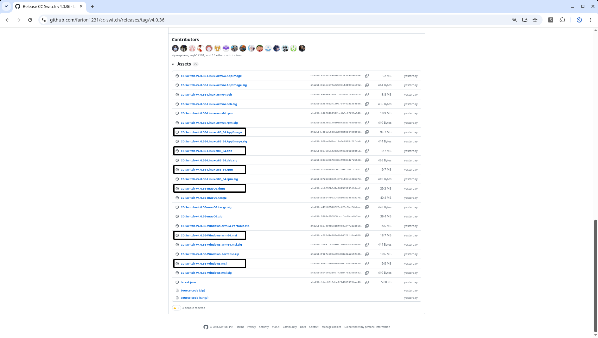
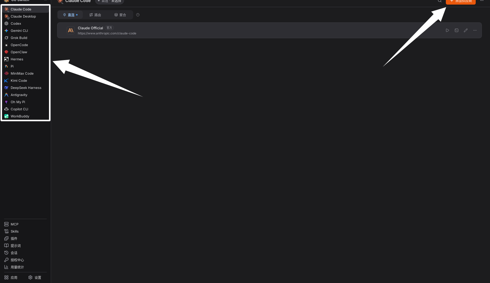
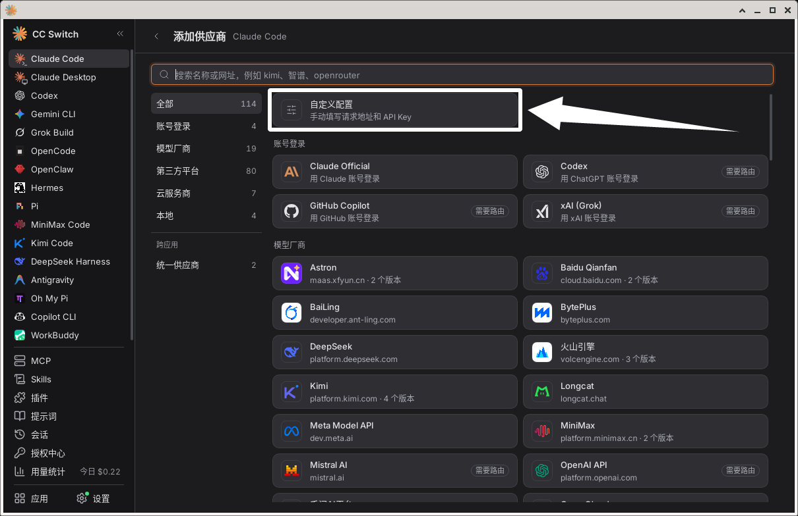
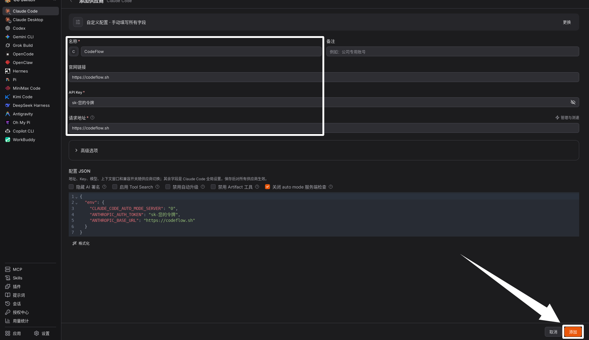
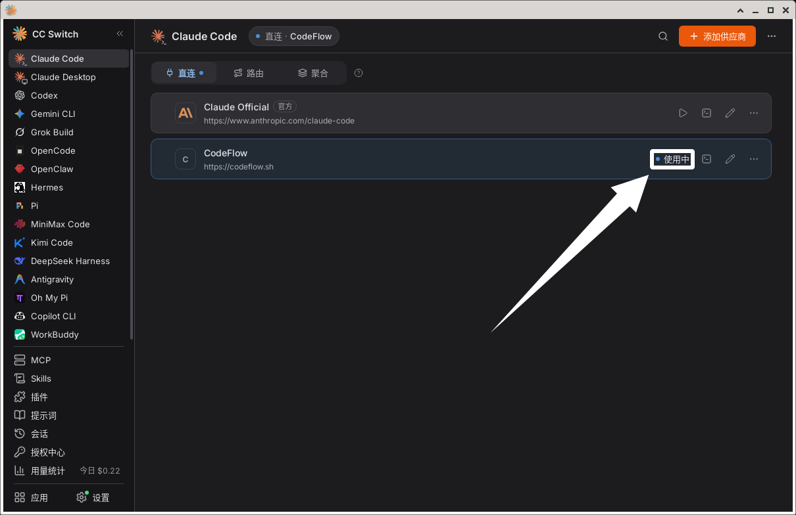
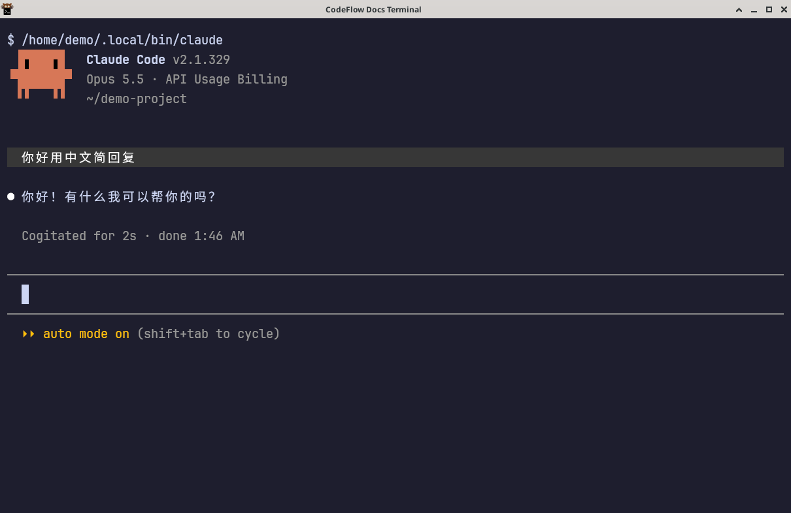

# CC Switch

CC Switch 是第三方图形化供应商配置管理工具，可在多个供应商之间切换 Claude Code 与 Codex 的连接配置。若只接入 {{SITE_NAME}}，使用官方 [CodeFlow 命令行工具](/guides/codeflow-cli.md) 即可一键完成配置

> **配置说明**
>
> 客户端界面与配置字段可能随版本更新变化，模型 ID 与可用分组以 {{SITE_NAME}} 控制台实时显示为准。本页依据 2026 年 11 月 21 日核验的信息整理，核验版本为 CC Switch v4.0.36

## 准备工作

- 已注册 {{SITE_NAME}} 账号并有可用额度，参见[快速开始](/guides/quick-start.md)
- 已创建分组与模型系列匹配的令牌，参见[接入凭证与分组](/guides/access.md)
- 本页的 Claude 配置使用不带 `/v1` 的接入地址（Base URL），Codex 配置使用带 `/v1` 的接入地址

## 安装 CC Switch

前往 [CC Switch GitHub Releases 页面](https://github.com/farion1231/cc-switch/releases/latest)，在最新版本的 **Assets** 区域选择适用于当前系统的安装包：Windows 推荐下载 `.msi` 文件，macOS 选择 `.dmg` 文件，Linux 可按需选择 AppImage、deb 或 rpm 格式



上图为 v4.0.36 Assets 列表的局部，安装包文件名中的版本号随发布更新

## 添加供应商

打开已安装的 CC Switch，在左侧客户端列表中选择要配置的客户端，例如 **Claude Code**



点击右上角的 **+ 添加供应商**，在打开的页面顶部选择 **自定义配置**



选择后页面切换为自定义配置表单

## 填写配置

|配置项|填写内容|
|---|---|
|**名称**|`{{SITE_NAME}}`|
|**官网链接**|`{{SITE_URL}}`|
|**API Key**|`sk-您的令牌`|
|**请求地址**|Claude 使用 `{{SITE_URL}}`（不带 `/v1`），Codex 使用 `{{SITE_URL}}/v1`|

接入地址需与当前选中的客户端一致，各客户端要求的地址格式见[接入凭证中的地址列表](/guides/access.md#base-url)

按表格填写配置，将 `sk-您的令牌` 替换为在 {{SITE_NAME}} 创建的令牌，填写完成后点击右下角的 **添加**



表单下方的 **配置 JSON** 会同步显示将写入 Claude Code 的配置，其中与接入相关的字段如下：

```json
{
  "env": {
    "ANTHROPIC_BASE_URL": "{{SITE_URL}}",
    "ANTHROPIC_AUTH_TOKEN": "sk-您的令牌"
  }
}
```

配置 Codex 时，在左侧客户端列表中选择 **Codex**，并使用带 `/v1` 的接入地址 `{{SITE_URL}}/v1`；模型 ID 和令牌字段按 CC Switch 当前表单填写。如需手动配置 `config.toml` 与 `auth.json`，参见 [Codex](/guides/codex.md)

## 保存并启用

添加成功后回到主界面，找到刚创建的供应商，确认卡片右侧显示 **使用中**。核验版本中新添加的供应商会自动启用；如果未显示 **使用中**，点击该卡片右侧的启用按钮（▷）



## 验证接入

在终端启动已配置的客户端：Claude Code 运行 `claude`，Codex 运行 `codex`。进入对话界面后，发送一条测试消息，收到正常响应，即表示接入成功。下图为 Claude Code v2.1.329 的验证示例，截图中以完整安装路径启动 `claude`



## 常见问题

|现象|处理方式|
|---|---|
|找不到 **+ 添加供应商** 或 **自定义配置**|最大化窗口，确认左侧客户端列表选中目标客户端|
|Claude 返回 401|确认令牌有效，且 `ANTHROPIC_BASE_URL` 不带 `/v1`|
|Codex 返回 401 或 404|核对两个配置文件与模型 ID，令牌须属 ChatGPT 官方分组|
