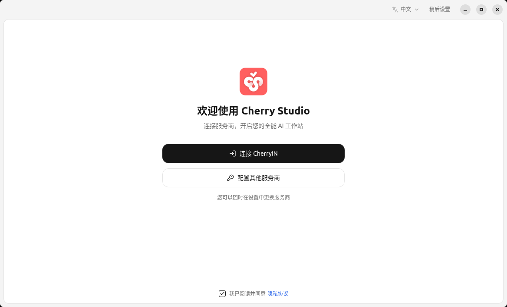
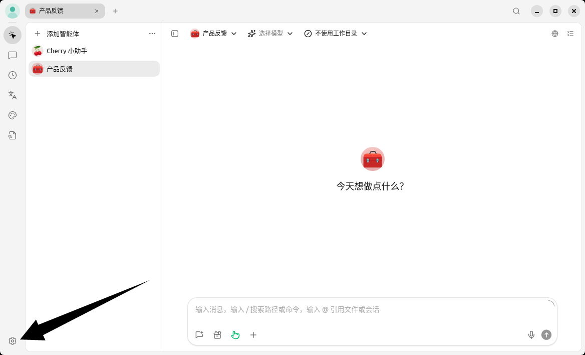
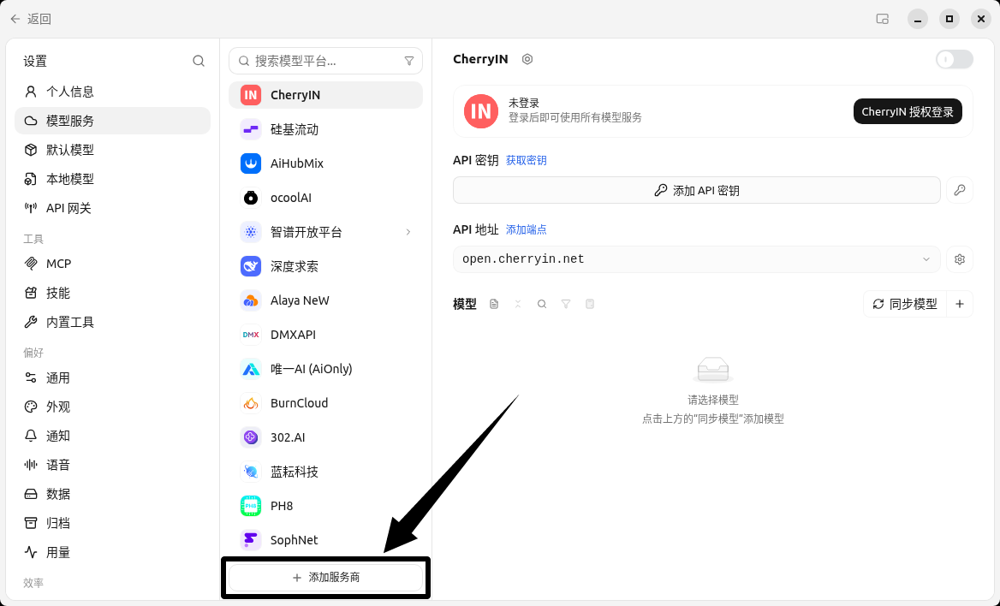
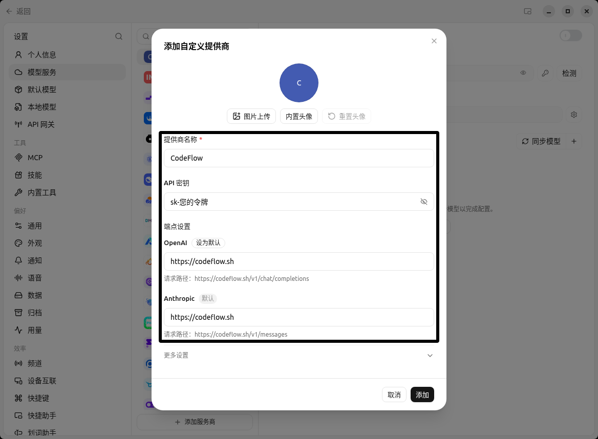
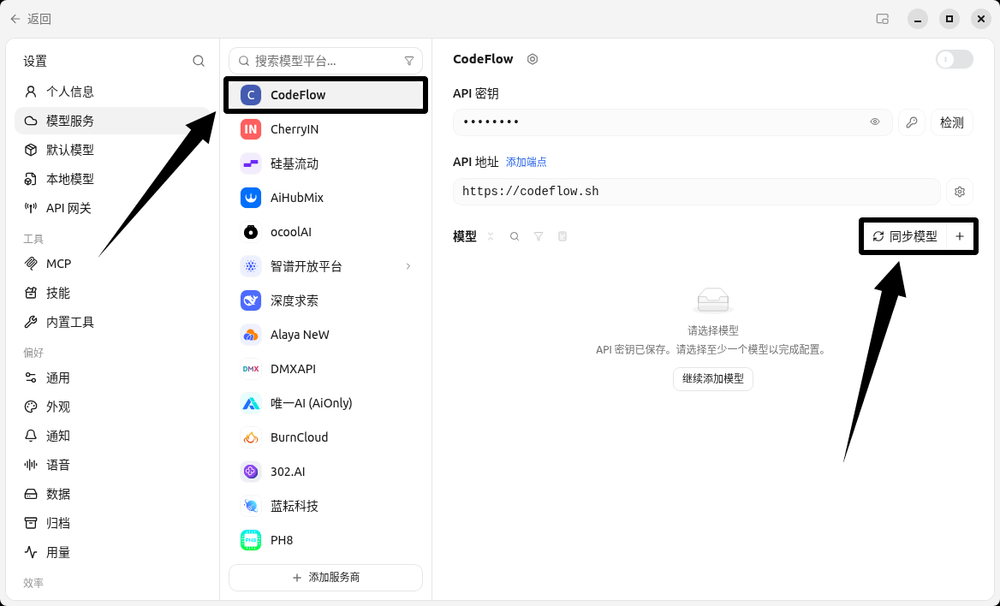
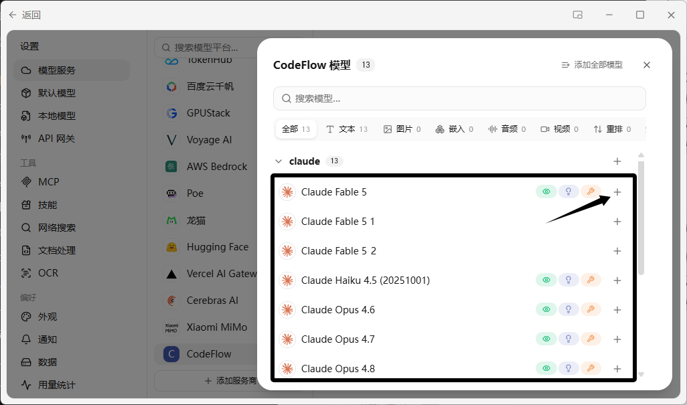
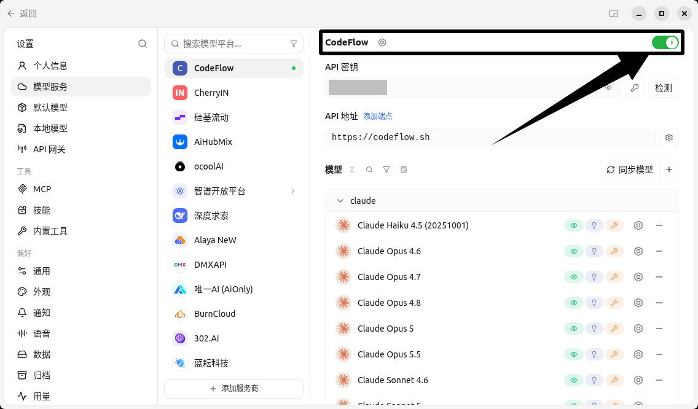

# Cherry Studio

Cherry Studio 是一款支持多供应商管理的桌面 AI 对话客户端。本页以 Anthropic 端点接入 {{SITE_NAME}} 为例，接入地址（Base URL）不带 `/v1`

> **配置说明**
>
> 客户端界面与配置字段可能随版本更新变化，模型 ID 与可用分组以 {{SITE_NAME}} 控制台实时显示为准。本页依据 2026 年 11 月 21 日核验的信息整理，核验版本为 Cherry Studio v2.2.3

## 准备工作

- 已注册 {{SITE_NAME}} 账号并有可用额度，参见[快速开始](/guides/quick-start.md)
- 已创建 Claude 系列分组的令牌，参见[接入凭证与分组](/guides/access.md)
- 本页使用的接入地址为 `{{SITE_URL}}`，不带 `/v1`

## 安装 Cherry Studio

从 [Cherry Studio 官方网站](https://www.cherry-ai.com/) 下载并启动客户端

首次启动会显示欢迎页。接入 {{SITE_NAME}} 无需登录 CherryIN 或其他账号，点击右上角的 **稍后设置** 进入主界面

## 添加供应商

点击左下角的设置图标，在 **模型服务** 页面点击服务商列表底部的 **添加服务商**

## 填写配置

在 **添加自定义提供商** 对话框中按下表填写：

|配置项|填写内容|
|---|---|
|**提供商名称**|`{{SITE_NAME}}`|
|**API 密钥**|在 {{SITE_NAME}} 创建的令牌|
|**端点设置**|**Anthropic** 填写 `{{SITE_URL}}`（不带 `/v1`），并保持为默认端点；**OpenAI** 可填写同一地址|
|令牌分组|Claude 系列分组|

填写后，**Anthropic** 下方的请求路径应显示为 `{{SITE_URL}}/v1/messages`

点击 **添加** 保存，然后在右侧供应商详情中点击 **同步模型**

在返回的列表中找到需要使用的模型，点击右侧的 **+** 添加模型

如需通过 OpenAI 端点接入，在 **端点设置** 的 **OpenAI** 中填写 `{{SITE_URL}}`，确认请求路径显示为 `{{SITE_URL}}/v1/chat/completions`，并使用 ChatGPT 官方分组的令牌

## 保存并启用

在供应商详情中打开右上角的启用开关，服务商列表中的 {{SITE_NAME}} 会显示绿色的启用标记

## 验证接入

新建对话并发送一条测试消息，收到正常响应，即表示接入成功

## 常见问题

|现象|处理方式|
|---|---|
|同步模型后列表为空|确认 **Anthropic** 为默认端点、地址不带 `/v1`，且令牌分组匹配|
|返回 401|重新复制令牌填入，确认无多余空格且分组正确|
